  
  
  
  
  

<b>🎮 Bonus levels →</b>

 

| Project | What it is | Links |
|---|---|---|
| **Java Fullstack Tracker** | A browser-only study tracker with 100-day beginner and 60-day interview tracks, flashcards, code exercises and DSA sets | [Live](https://java60days.vercel.app) · [Code](https://github.com/sarthakm10/java_60_days) |
| **Java DSA Notes** | Java + DSA notes and solutions, worked through problem by problem | [Code](https://github.com/sarthakm10/Java_Notes_Kunal_DSA_PlayList) |
| **Little Lemon** | A React restaurant site with menu and table reservations (Meta Front-End course) | [Live](https://little-lemon-website-inky.vercel.app/) · [Code](https://github.com/sarthakm10/Little_Lemon_Website) |
| **RobotShop** | An Angular 16 storefront built while learning Angular | [Live](https://angular-learning-project-sarthakm10s-projects.vercel.app/) · [Code](https://github.com/sarthakm10/Angular-Learning-Project) |

   
  
   
  
    
  
  
  

<picture>
  <source media="(prefers-color-scheme: dark)" srcset="https://raw.githubusercontent.com/sarthakm10/sarthakm10/output/snake-dark.svg"/>
  <source media="(prefers-color-scheme: light)" srcset="https://raw.githubusercontent.com/sarthakm10/sarthakm10/output/snake.svg"/>
  
</picture>

